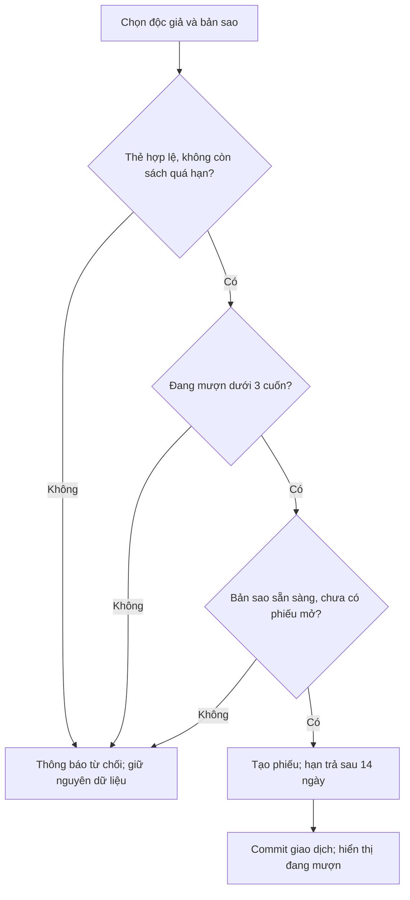
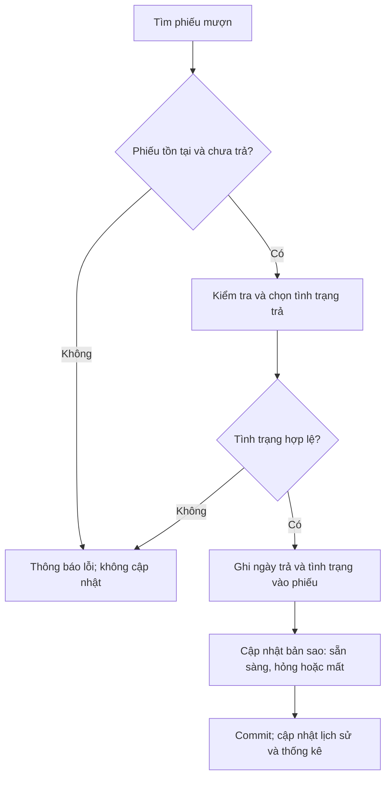
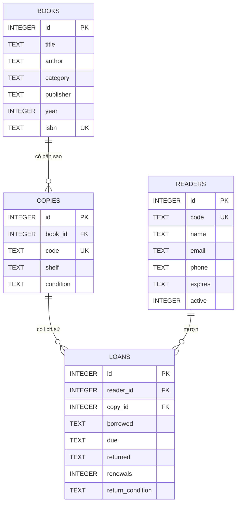

# BÁO CÁO BÀI THỰC HÀNH
# PHÂN TÍCH, THIẾT KẾ VÀ XÂY DỰNG HỆ THỐNG QUẢN LÝ THƯ VIỆN ỨNG DỤNG CÔNG CỤ AI

| Thông tin | Nội dung |
|---|---|
| Sinh viên | Dương Gia |
| MSSV | 30219256283 |
| Tên dự án | Lab_QLThuVien_30219256283_DuongGia |
| Ngày lập báo cáo | 23/11/2026 |
| Môn học / Lớp / Giảng viên | [Sinh viên bổ sung] |
| Công nghệ triển khai | Python, SQLite, HTML, CSS, JavaScript |
| Công cụ AI trong phiên xây dựng | ChatGPT/Codex |
| Minh chứng Google AI Studio / Antigravity IDE | Chưa bổ sung; cần thực hiện theo mục 7 |
| Repository GitHub | Chưa tạo/push; cần cập nhật theo mục 9 |

## 1. Giới thiệu và phạm vi

### 1.1. Bối cảnh

Ghi chép thủ công khiến thông tin mượn trả dễ nhầm lẫn, khó biết một cuốn đang ở kho hay được mượn, đồng thời làm chậm tra cứu và thống kê. Hệ thống được xây dựng để quản lý đầu sách, bản sao vật lý, độc giả và lịch sử mượn trả bằng một nguồn dữ liệu SQLite.

### 1.2. Mục tiêu

- Chuẩn hóa dữ liệu sách và độc giả; tra cứu nhanh bằng nhiều thuộc tính.
- Kiểm soát mượn/trả/gia hạn theo các quy tắc được công bố.
- Phân biệt đầu sách và từng bản sao để theo dõi sách đang mượn, hỏng hoặc mất.
- Tự động tính hạn trả, nhận diện quá hạn và cung cấp thống kê.
- Thực hành phân tích, lập trình, rà soát bằng AI và kiểm chứng lại bằng kiểm thử.

### 1.3. Phạm vi và giả định

Ứng dụng phục vụ một thủ thư trên máy cục bộ. Độc giả là đối tượng được quản lý, chưa có màn hình đăng nhập riêng. Một phiếu mượn tương ứng một bản sao; mượn nhiều cuốn tạo nhiều phiếu độc lập. Hệ thống chưa xử lý đặt chỗ, tiền phạt, bồi thường, thanh toán, nhiều chi nhánh hoặc phân quyền người dùng.

Các giới hạn 3 cuốn, 14 ngày và gia hạn 7 ngày là **giả định thiết kế cho bài lab**, không khẳng định là quy chế của thư viện trường. AI hỗ trợ quá trình phát triển; sản phẩm không có tính năng AI tích hợp lúc chạy.

## 2. Phân tích yêu cầu

### 2.1. Tác nhân

| Tác nhân | Vai trò |
|---|---|
| Thủ thư | Quản lý dữ liệu, lập phiếu, nhận trả, gia hạn, theo dõi quá hạn và xuất thống kê |
| Độc giả | Cung cấp thẻ, yêu cầu mượn/trả/gia hạn; thao tác được thủ thư nhập vào hệ thống |
| Hệ thống | Xác thực điều kiện, cập nhật dữ liệu, tính hạn trả và tổng hợp thống kê |

### 2.2. Danh sách chức năng

| Mã | Nhóm chức năng | Đầu vào | Xử lý và đầu ra |
|---|---|---|---|
| F01 | Tổng quan | Dữ liệu hiện tại | Số đầu sách, bản sao sẵn sàng, đang mượn và phiếu quá hạn |
| F02 | Quản lý đầu sách | Tên, tác giả, thể loại, NXB, năm, ISBN/mã | Thêm, sửa, xóa có kiểm tra tham chiếu |
| F03 | Quản lý bản sao | Đầu sách, mã cuốn, kệ, tình trạng | Quản lý từng cuốn vật lý; không sửa bản sao đang mượn |
| F04 | Quản lý độc giả | Mã thẻ, họ tên, liên hệ, hạn thẻ, trạng thái | Thêm, sửa, xóa thẻ chưa có lịch sử, khóa/mở thẻ |
| F05 | Tra cứu và lọc | Từ khóa, thể loại/trạng thái | Danh sách phù hợp, tìm kiếm có dấu hoặc không dấu |
| F06 | Lập phiếu mượn | Độc giả và bản sao | Kiểm tra điều kiện; tạo phiếu và hạn trả tự động |
| F07 | Trả sách | Phiếu, tình trạng trả | Đóng phiếu; cập nhật bản sao sẵn sàng/hỏng/mất |
| F08 | Gia hạn | Phiếu đang mở | Tăng hạn trả thêm 7 ngày khi thỏa điều kiện |
| F09 | Lịch sử độc giả | Độc giả | Danh sách phiếu đã/đang mượn của người đó |
| F10 | Thống kê | Kho và lịch sử | Phân bố tình trạng kho, top 5 đầu sách theo lượt mượn, phiếu quá hạn |
| F11 | Xuất CSV | Danh sách hiện tại | CSV UTF-8 có BOM, giữ bộ lọc; trang thống kê xuất toàn bộ lịch sử |

### 2.3. Quy tắc nghiệp vụ

| Mã | Quy tắc |
|---|---|
| BR01 | Mỗi bản sao có mã duy nhất và thuộc đúng một đầu sách. ISBN/mã danh mục và mã độc giả không trùng. |
| BR02 | Chỉ mượn khi thẻ hoạt động và ngày hết hạn thẻ không trước hôm nay. |
| BR03 | Độc giả còn phiếu chưa trả có hạn trả trước hôm nay không được mượn/gia hạn. |
| BR04 | Một độc giả có tối đa 3 phiếu chưa trả; đúng 3 cuốn thì không mượn thêm. |
| BR05 | Bản sao phải nguyên vẹn/sẵn sàng và không có phiếu đang mở. |
| BR06 | Ngày mượn lấy từ ngày máy chủ; hạn trả = ngày mượn + 14 ngày lịch. |
| BR07 | Gia hạn tối đa 1 lần; hạn mới = hạn cũ + 7 ngày. Chỉ phiếu chưa trả và độc giả đủ điều kiện mới được gia hạn. |
| BR08 | Đúng ngày hạn trả chưa tính quá hạn. Số ngày quá hạn = max(0, ngày xét - hạn trả). |
| BR09 | Trả được phép kể cả thẻ khóa/hết hạn; phiếu đã trả không được trả hay gia hạn lần nữa. |
| BR10 | Trả nguyên vẹn làm bản sao sẵn sàng. Hỏng/mất đóng phiếu nhưng bản sao không được mượn tiếp. Chưa tính bồi thường. |
| BR11 | Không xóa độc giả/bản sao có bất kỳ lịch sử mượn nào. Không xóa đầu sách còn bản sao. |
| BR12 | Không sửa trực tiếp bản sao đang mượn. Muốn ghi nhận mất/hỏng trong lần mượn phải dùng thao tác trả. |

### 2.4. Yêu cầu phi chức năng

- Lưu bền vững trong SQLite; khởi động lại không tạo lặp dữ liệu mẫu.
- Mọi truy vấn nhận giá trị từ người dùng được tham số hóa.
- Thao tác ghi dùng giao dịch; `BEGIN IMMEDIATE` tuần tự hóa thao tác kiểm tra và ghi mượn. Chỉ mục duy nhất bảo vệ một phiếu mở trên một bản sao.
- Chỉ phục vụ tài nguyên tĩnh theo danh sách cho phép; không mở trực tiếp file DB ra HTTP.
- API ghi nhận JSON, giới hạn body 64 KiB, từ chối Origin khác, không bật CORS; giao diện escape dữ liệu nhập trước khi hiển thị.
- Giao diện tiếng Việt, có trạng thái rỗng, lỗi biểu mẫu và xác nhận xóa/gia hạn. CSS có bố cục thích ứng, cần kiểm tra thực tế trên các kích thước màn hình.
- Các biện pháp trên phục vụ demo cục bộ, không thay thế cơ chế xác thực và bảo mật khi triển khai thật.

## 3. Quy trình nghiệp vụ

### 3.1. Quy trình mượn

Tiền điều kiện: tồn tại độc giả và bản sao. Thủ thư chọn một người và một cuốn; backend kiểm tra lại dữ liệu hiện tại trong giao dịch, không chỉ dựa trên tùy chọn của giao diện. Nếu kiểm tra thất bại, trả lỗi và không tạo phiếu.

### 3.2. Quy trình trả

Thủ thư tìm phiếu, kiểm tra cuốn thực tế và chọn tình trạng. Ghi nhận phiếu và cập nhật bản sao phải cùng thành công hoặc cùng được rollback. Trạng thái mất đóng trách nhiệm mượn trong phạm vi demo, chưa kết luận nghĩa vụ bồi thường.

### 3.3. Quy trình gia hạn

Chọn phiếu chưa trả → kiểm tra thẻ và toàn bộ phiếu quá hạn của độc giả → kiểm tra số lần gia hạn < 1 → tăng hạn trả hiện tại 7 ngày và số lần gia hạn thêm 1. Nếu phiếu có hạn trả đúng hôm nay vẫn được gia hạn, với điều kiện người mượn không có phiếu quá hạn khác.

### 3.4. Trạng thái bản sao

`copies.condition` chỉ lưu tình trạng vật lý: available, damaged, lost. Trạng thái borrowed được suy ra khi có một phiếu chưa trả. Cách này tránh lưu hai trường trạng thái mượn dễ lệch nhau. Khi chấp nhận trả, `return_condition` lưu tình trạng tại thời điểm đó; sửa tình trạng bản sao sau này không thay đổi lịch sử trả cũ.

## 4. Thiết kế dữ liệu

### 4.1. Mô hình quan hệ

### 4.2. Bảng books - Đầu sách

| Trường | Kiểu SQLite | Ràng buộc / Ý nghĩa |
|---|---|---|
| id | INTEGER | Khóa chính, tự sinh khi không cung cấp |
| title | TEXT | NOT NULL; ứng dụng kiểm tra không trắng, tối đa 200 ký tự |
| author | TEXT | NOT NULL; tối đa 200 ký tự |
| category | TEXT | NOT NULL; tối đa 80 ký tự |
| publisher | TEXT | NOT NULL, mặc định chuỗi rỗng; tối đa 200 ký tự |
| year | INTEGER | DB giới hạn 1000..2100; ứng dụng giới hạn thêm không vượt năm hiện tại |
| isbn | TEXT | NOT NULL, UNIQUE; tối đa 40 ký tự, cho phép mã danh mục nội bộ |

### 4.3. Bảng copies - Bản sao vật lý

| Trường | Kiểu SQLite | Ràng buộc / Ý nghĩa |
|---|---|---|
| id | INTEGER | Khóa chính |
| book_id | INTEGER | NOT NULL, khóa ngoại đến books.id, ON DELETE RESTRICT |
| code | TEXT | NOT NULL, UNIQUE; tối đa 40 ký tự |
| shelf | TEXT | NOT NULL; vị trí kệ, tối đa 40 ký tự |
| condition | TEXT | CHECK available/damaged/lost; mặc định available |

### 4.4. Bảng readers - Độc giả

| Trường | Kiểu SQLite | Ràng buộc / Ý nghĩa |
|---|---|---|
| id | INTEGER | Khóa chính |
| code | TEXT | NOT NULL, UNIQUE; tối đa 40 ký tự |
| name | TEXT | NOT NULL; tối đa 120 ký tự |
| email | TEXT | Chuỗi rỗng hoặc email hợp lệ theo kiểm tra cơ bản; tối đa 120 ký tự |
| phone | TEXT | Chuỗi rỗng hoặc số liên hệ có ký tự cho phép; tối đa 20 ký tự |
| expires | TEXT | NOT NULL, ngày ISO YYYY-MM-DD; ứng dụng xác thực ngày tồn tại |
| active | INTEGER | CHECK 0/1; 1 hoạt động, 0 khóa thẻ |

### 4.5. Bảng loans - Phiếu mượn

| Trường | Kiểu SQLite | Ràng buộc / Ý nghĩa |
|---|---|---|
| id | INTEGER | Khóa chính |
| reader_id | INTEGER | NOT NULL, FK readers.id, ON DELETE RESTRICT |
| copy_id | INTEGER | NOT NULL, FK copies.id, ON DELETE RESTRICT |
| borrowed | TEXT | Ngày mượn do máy chủ tạo |
| due | TEXT | Hạn trả, CHECK không trước ngày mượn |
| returned | TEXT hoặc NULL | NULL nếu chưa trả; CHECK không trước ngày mượn |
| renewals | INTEGER | Mặc định 0, CHECK 0..1 |
| return_condition | TEXT hoặc NULL | available/damaged/lost khi đã trả; NULL nếu phiếu mở |

`CHECK` yêu cầu ngày trả và tình trạng trả cùng NULL hoặc cùng có giá trị. Chỉ mục `one_open_loan_per_copy` là UNIQUE trên `copy_id` với điều kiện `returned IS NULL`; mỗi cuốn có thể có nhiều phiếu lịch sử nhưng tối đa một phiếu mở. `loans_reader` hỗ trợ truy vấn theo độc giả. `PRAGMA foreign_keys = ON` được bật cho từng kết nối. `PRAGMA user_version` đánh dấu đã khởi tạo DB để không lặp dữ liệu mẫu.

### 4.6. Dữ liệu mẫu

| Thành phần | Số lượng ban đầu | Tình huống |
|---|---|---|
| Đầu sách | 8 | Công nghệ, kinh tế, văn học, ngoại ngữ, khoa học, kỹ năng |
| Bản sao | 24 | 21 sẵn sàng, 2 đang mượn, 1 hư hỏng |
| Độc giả | 4 | DG001..DG004; dữ liệu giả lập |
| Phiếu | 3 | 1 quá hạn đang mở, 1 đang mượn đúng hạn, 1 đã trả |

Ngày mẫu tính tương đối từ ngày chạy lần đầu. Hạn thẻ không tự dịch chuyển khi chạy lại DB cũ. Toàn bộ nội dung danh mục là dữ liệu minh họa, không phải danh mục thư viện thật.

## 5. Thiết kế và triển khai ứng dụng

### 5.1. Kiến trúc

Trình duyệt hiển thị HTML/CSS/JavaScript và gọi API JSON. `app.py` tiếp nhận HTTP, giới hạn đường dẫn và chuẩn hóa phản hồi. `core.py` kiểm tra nghiệp vụ, thực hiện truy vấn trong giao dịch và trả snapshot dữ liệu. `schema.sql` định nghĩa cấu trúc SQLite. Không cần dịch vụ lưu trữ bên ngoài.

Chọn SQLite vì phù hợp dữ liệu quan hệ, hỗ trợ ràng buộc, giao dịch và lưu trong file, giúp quan sát nghiệp vụ rõ hơn so với lưu toàn bộ dữ liệu giao diện trong LocalStorage. Python dùng thư viện chuẩn, thuận tiện giải nén và chạy trong phạm vi bài thực hành.

### 5.2. Ánh xạ màn hình

| Màn hình | Nội dung chính | Chức năng |
|---|---|---|
| Tổng quan | Thẻ số liệu, hoạt động gần đây, phân bố đầu sách | F01 |
| Danh mục sách | Danh sách, biểu mẫu, tìm và lọc thể loại | F02, F05, F11 |
| Kho bản sao | Mã cuốn, kệ, tình trạng, biểu mẫu | F03, F05, F11 |
| Độc giả | Thẻ, liên hệ, hạn thẻ, lịch sử | F04, F05, F09, F11 |
| Mượn & trả | Phiếu, hạn trả, gia hạn, trả sách | F06, F07, F08, F11 |
| Thống kê | Tình trạng kho, top lượt mượn, danh sách thu hồi | F10, F11 |

### 5.3. API

| Phương thức | Đường dẫn | Chức năng |
|---|---|---|
| GET | /api/state | Đọc nhất quán books, copies, readers, loans, ngày hiện tại |
| POST | /api/books/create, update, delete | Thêm/sửa/xóa đầu sách (mỗi thao tác là một đường dẫn đầy đủ) |
| POST | /api/copies/create, update, delete | Thêm/sửa/xóa bản sao |
| POST | /api/readers/create, update, delete | Thêm/sửa/xóa độc giả |
| POST | /api/loans/create | Lập phiếu; truyền reader_id, copy_id |
| POST | /api/loans/renew | Gia hạn; truyền id phiếu |
| POST | /api/loans/return | Trả; truyền id phiếu và condition |

Ví dụ nhóm books gồm `/api/books/create`, `/api/books/update`, `/api/books/delete`. POST yêu cầu Content-Type application/json. Phản hồi thành công có `ok: true`; lỗi có `error`. Mã lỗi chính: 400 dữ liệu/nghiệp vụ sai, 403 Origin khác, 404 tài nguyên không tồn tại, 409 xung đột ràng buộc, 413 dung lượng body không hợp lệ, 415 sai Content-Type, 503 SQLite bận/chưa sẵn sàng.

### 5.4. Khởi chạy

Tại thư mục dự án, chạy `python src/app.py`, mở http://127.0.0.1:8000. DB được tạo khi chạy đầu. Chi tiết cài đặt, đổi cổng, sao lưu và tạo DB thử mới nằm trong README. Không cần cài thêm gói Python; Node chỉ dùng kiểm tra cú pháp JavaScript nếu có.

## 6. Kiểm thử và kết quả

### 6.1. Môi trường và phương pháp

Ngày kiểm thử: 23/11/2026. Môi trường tạo bài: Windows, Python 3.13.3, Node.js 24.15.0. Lệnh: `python -m unittest discover -s tests -v`. SQLite tạm được tạo riêng cho các kiểm thử, không tác động DB demo. Có kiểm thử nghiệp vụ, dữ liệu biên, cạnh tranh mượn và xử lý request HTTP thô qua stream trong bộ nhớ.

Kết quả lần chạy cuối: **26/26 phương thức kiểm thử đạt**, log thật trong `minh_chung/test_results.txt`. `node --check src/static/app.js` hoàn tất với mã thoát 0. Kiểm thử HTTP trong bộ nhớ không xác minh kết nối TCP, trình duyệt, CSS hay tương tác DOM.

### 6.2. Bảng kiểm thử tự động

| ID | Tình huống / Đầu vào | Kết quả mong đợi | Thực tế |
|---|---|---|---|
| TC01 | Khởi tạo DB mẫu | 8 sách, 24 bản sao, 4 độc giả, 3 phiếu; 21 sẵn sàng | Đạt |
| TC02 | Tạo sách và một bản sao mới | Sinh ID, bản sao tăng lên 25 | Đạt |
| TC03 | Tạo sách trùng DEMO-001 | Từ chối, rollback, không thêm dòng | Đạt |
| TC04 | Tên trắng hoặc năm lớn hơn năm hiện tại | Từ chối dữ liệu không hợp lệ | Đạt |
| TC05 | DG004 mượn bản sao sẵn sàng | Tạo phiếu, hạn +14 ngày, trạng thái borrowed | Đạt |
| TC06 | Mượn bản sao đã có phiếu mở | Từ chối mượn trùng | Đạt |
| TC07 | DG004 đang mượn 3 cuốn, mượn cuốn thứ tư | Từ chối vượt giới hạn | Đạt |
| TC08 | DG001 còn phiếu quá hạn | Không được mượn tiếp | Đạt |
| TC09 | Thẻ khóa hoặc hết hạn hôm qua | Từ chối mượn | Đạt |
| TC10 | Hạn thẻ đúng hôm nay | Cho mượn khi các điều kiện khác hợp lệ | Đạt |
| TC11 | Mượn bản sao hỏng hoặc mất | Từ chối | Đạt |
| TC12 | Gia hạn phiếu hợp lệ hai lần | Lần đầu +7 ngày; lần sau từ chối | Đạt |
| TC13 | Gia hạn phiếu quá hạn | Từ chối | Đạt |
| TC14 | Trả hư hỏng; sau đó trả/gia hạn lại | Bản sao hỏng; các thao tác lại bị từ chối | Đạt |
| TC15 | Trả nguyên vẹn rồi mượn cuốn đó | Cho mượn lại | Đạt |
| TC16 | Xóa độc giả/bản sao có lịch sử, xóa sách còn bản sao | Từ chối, bảo toàn dữ liệu | Đạt |
| TC17 | Email sai, ngày 30/02, điện thoại sai | Từ chối | Đạt |
| TC18 | Sửa bản sao đang mượn | Từ chối, yêu cầu xử lý trả | Đạt |
| TC19 | Ghi trả mất, khởi tạo lại cùng DB | Dữ liệu giữ nguyên, không lặp mẫu | Đạt |
| TC20 | Hai luồng mượn đồng thời một bản sao | Chính xác một yêu cầu thành công | Đạt |
| TC21 | Sửa/xóa độc giả mới, xóa bản sao chưa có lịch sử | Thao tác hợp lệ thành công | Đạt |
| TC22 | Hạn trả đúng hôm nay | Chưa quá hạn; gia hạn được | Đạt |
| TC23 | GET HTML/JS/CSS/snapshot qua handler | HTTP 200, có header bảo vệ và nội dung | Đạt |
| TC24 | JSON hỏng, JSON array hoặc sai Content-Type | 400 hoặc 415 tương ứng | Đạt |
| TC25 | POST mượn rồi trả qua handler | Hai phản hồi 200, ghi DB thành công | Đạt |
| TC26 | Đường dẫn ngoài danh sách / Origin khác | 404 và 403 tương ứng | Đạt |

### 6.3. Kiểm thử giao diện cần bổ sung

Việc mở trang cục bộ trong trình duyệt tại môi trường tạo bài không thành công: trình duyệt trong ứng dụng báo hết thời gian kết nối, công cụ điều khiển Edge dừng vì không xác định URL hiện tại. Vì vậy chưa có ảnh chạy UI và không khẳng định đã kiểm thử E2E. Sinh viên cần chạy các mục dưới đây trên máy và cập nhật kết quả thực tế.

| ID | Bước kiểm tra | Mong đợi | Kết quả thực tế |
|---|---|---|---|
| UI01 | Khởi động, mở URL trong README | Dashboard tải đúng mẫu | Chưa thực hiện |
| UI02 | Tìm "co so du lieu", lọc Công nghệ | Tìm được sách đúng khi không gõ dấu | Chưa thực hiện |
| UI03 | Thêm/sửa đầu sách; thêm bản sao | Bản ghi hiển thị và lưu sau tải lại | Chưa thực hiện |
| UI04 | Mượn với DG004 rồi gia hạn và trả | Trạng thái và số liệu cập nhật | Chưa thực hiện |
| UI05 | Mượn với DG001 đang quá hạn | Hiển thị lỗi cụ thể, không tạo phiếu | Chưa thực hiện |
| UI06 | Trả hỏng/mất; kiểm tra kho | Bản sao không còn trong lựa chọn cho mượn | Chưa thực hiện |
| UI07 | Xuất CSV sau khi lọc | Nội dung tiếng Việt đúng và chỉ gồm dòng phù hợp | Chưa thực hiện |
| UI08 | Mở ở màn hình 393 px và desktop | Điều hướng, biểu mẫu và cuộn bảng sử dụng được | Chưa thực hiện |
| UI09 | Nhập tên chứa ký tự HTML | Hiển thị như văn bản, không thực thi mã | Chưa thực hiện |
| UI10 | Tắt/mở app với cùng DB | Giữ dữ liệu đã ghi | Chưa thực hiện |

### 6.4. Đánh giá

Kết quả tự động củng cố tính đúng của nghiệp vụ và bộ xử lý HTTP trong phạm vi đã kiểm tra, chưa đủ kết luận mọi chức năng giao diện hoạt động hoàn hảo. Chưa đo hiệu năng dữ liệu lớn, chưa kiểm thử tải nhiều người dùng, chưa kiểm toán bảo mật toàn diện. Cần hoàn tất UI01..UI10 trước khi nộp để xác nhận trải nghiệm sử dụng thực tế.

## 7. Quá trình ứng dụng công cụ AI

### 7.1. Phần đã thực hiện trong phiên tạo bài

ChatGPT/Codex hỗ trợ phân tích, sinh mã nguồn, thiết kế kiểm thử, chạy kiểm thử và soạn báo cáo. Từ yêu cầu ban đầu, sản phẩm được cụ thể hóa thành bốn bảng liên kết và sáu màn hình; các kiểm thử kiểm chứng điều kiện nghiệp vụ thay vì xem mã AI là mặc nhiên đúng.

### 7.2. Phần sinh viên cần thực hiện theo yêu cầu công cụ

Đề bài yêu cầu minh chứng Google AI Studio/Antigravity IDE. Các ảnh này chưa được tạo trong phiên hiện tại. File `PROMPTS_AI.md` chứa ba prompt phân tích, rà soát mã và thiết kế kiểm thử để chạy thực tế, kèm bảng nhật ký. Sinh viên cần mở dự án, chạy prompt, ghi phản hồi và nêu điều chỉnh thực sự đã thực hiện.

| Hình | Bằng chứng cần thêm | Trạng thái |
|---|---|---|
| Hình 1 | Google AI Studio: prompt và phản hồi phân tích | Chưa bổ sung |
| Hình 2 | Antigravity IDE: cây dự án và mã nguồn | Chưa bổ sung |
| Hình 3 | Terminal khởi động ứng dụng | Chưa bổ sung |
| Hình 4 | Giao diện tổng quan | Chưa bổ sung |
| Hình 5 | Lập phiếu mượn thành công | Chưa bổ sung |
| Hình 6 | Trả sách và bản sao cập nhật | Chưa bổ sung |
| Hình 7 | Từ chối thao tác vi phạm nghiệp vụ | Chưa bổ sung |
| Hình 8 | Repository GitHub sau khi push | Chưa bổ sung |

Chèn ảnh thật vào mục này sau khi lưu trong `minh_chung/`. Không dùng ảnh dựng hoặc mô tả kết quả giả làm minh chứng. Với Markdown, có thể chèn theo cú pháp `` sau khi tệp tồn tại.

## 8. Kết luận và hướng phát triển

Sản phẩm đã có mã nguồn, dữ liệu mẫu tự tạo, thiết kế dữ liệu, các luồng mượn/trả/gia hạn và bộ kiểm thử. Việc tách đầu sách khỏi bản sao và bảo vệ lịch sử giúp theo dõi tồn kho rõ ràng. Giao dịch và chỉ mục duy nhất giảm nguy cơ mượn trùng khi có thao tác đồng thời.

Hướng phát triển gồm đăng nhập và phân quyền, nhật ký thao tác, mã vạch, đặt chỗ, quy trình bồi thường được phê duyệt, phân trang và lọc theo thời gian. Nếu triển khai thật, cần dùng máy chủ phù hợp, kiểm soát truy cập, sao lưu tự động và rà soát bảo mật. Trước khi nộp bài hiện tại, cần bổ sung minh chứng công cụ, kiểm thử UI thực tế và repository GitHub.

## 9. Thông tin nộp bài

- Thư mục: `Lab_QLThuVien_30219256283_DuongGia`.
- Tệp nén: `30219256283_DuongGia_LabQLThuVien.zip`.
- Báo cáo: `BaoCao_Lab.md` - chọn định dạng Markdown theo đề bài. Các sơ đồ dùng Mermaid, xem bằng trình đọc hỗ trợ Mermaid như GitHub.
- Mã nguồn: `src/`; hướng dẫn chạy: `README.md`; kiểm thử: `tests/`.
- GitHub: **[Điền URL sau khi push thành công]**.
- Commit nộp bài: **[Điền commit thực tế]**.
- Kết quả kiểm thử UI: **[Điền sau khi chạy UI01..UI10]**.

Hướng dẫn Git đã chuẩn bị trong README. Chưa tạo/push repository do chưa có đích repository và kết nối GitHub xác thực trong phiên này.

## 10. Tài liệu tham khảo

Các nguồn chính thức dưới đây mô tả công nghệ nền. Không sử dụng chúng làm bằng chứng ứng dụng đã chạy trên máy sinh viên.

1. Python Software Foundation. *sqlite3 - DB-API 2.0 interface for SQLite databases*. https://docs.python.org/3/library/sqlite3.html. Tra cứu 23/11/2026.
2. Python Software Foundation. *http.server - HTTP servers*. https://docs.python.org/3/library/http.server.html. Tra cứu 23/11/2026. Lưu ý giới hạn máy chủ HTTP phục vụ phát triển/thực hành.
3. Python Software Foundation. *unittest - Unit testing framework*. https://docs.python.org/3/library/unittest.html. Tra cứu 23/11/2026.
4. MDN Web Docs. *Window: localStorage property*. https://developer.mozilla.org/en-US/docs/Web/API/Window/localStorage. Tra cứu 23/11/2026; tham khảo khi lựa chọn phương án lưu dữ liệu.
